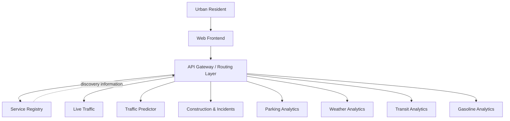

# Smart City Microservices Platform

> **Project documentation status:** Initial documentation scaffold. Replace placeholders and confirm implementation details against the team's code, PR1 requirements, and deployment configuration before treating them as final.

## 1. Project Overview

The Smart City Microservices Platform is intended to help urban residents understand and navigate city conditions through a unified application. It brings together independently developed services that provide traffic, incident, parking, weather, transit, and fuel-price information.

The platform is designed around independently deployable services with clearly defined interfaces. A web frontend presents information to users, while backend infrastructure routes requests to the appropriate service.

## 2. Project Objectives

- Provide a unified interface for accessing multiple categories of city information.
- Separate domain capabilities into independently maintainable microservices.
- Define consistent API contracts and service-discovery behaviour.
- Support monitoring, testing, and deployment of individual services.
- Evaluate the architecture against the project's functional requirements and Architectural Significant Requirements (ASRs).

## 3. System Components

| Component | Responsibility |
|---|---|
| Frontend | User-facing dashboard and interaction |
| API Gateway / routing layer | Entry point for client requests; routes requests to backend capabilities |
| Service Registry | Maintains logical service and instance information for discovery |
| Live Traffic | Current traffic and congestion information |
| Traffic Predictor | Historical analysis and future congestion estimates |
| Construction & Incidents | Construction and incident reports |
| Parking Analytics | Parking availability, congestion, and pricing information |
| Weather Analytics | Weather and air-quality information |
| Transit Analytics | Public-transit analysis |
| Gasoline Analytics | Gasoline prices and station information |

The exact responsibilities and boundaries should be confirmed by the team as the services are implemented.

## 4. High-Level Architecture



This is a conceptual view, not a deployment diagram. It does not imply that every service call must synchronously query the registry. The implementation should define discovery caching, failure handling, and routing behaviour.

## 5. Technology Stack

| Area | Current project direction |
|---|---|
| Frontend | Next.js / React |
| Backend services | Python / FastAPI |
| Cloud platform | Google Cloud Platform |
| Container deployment | Docker; Cloud Run is the planned/selected initial hosting direction |
| Source control | Git and GitHub |

Confirm versions, build tooling, persistence technologies, and deployed resources from the repository before final submission.

## 6. Repository Structure

```text
Smart-City-Microservices/
├── README.md
├── docs/
│   ├── architecture/
│   ├── requirements/
│   ├── api/
│   └── project/
├── frontend/
├── service-registry/
├── services/
│   ├── live-traffic/
│   ├── traffic-predictor/
│   ├── construction-incidents/
│   ├── parking-analytics/
│   ├── weather-analytics/
│   ├── transit-analytics/
│   └── gasoline-analytics/
├── infrastructure/
├── shared/
└── scripts/
```

## 7. Local Development

The commands below are examples. Follow each component's README and the root `docker-compose.yml` once those are populated and validated.

```powershell
# From the repository root
docker compose up --build
```

For an individual Python service, create and activate a virtual environment, install that service's `requirements.txt`, and run its documented ASGI entry point. Do not assume all services use the same port.

## 8. Documentation Index

- [System architecture](docs/architecture/system-architecture.md)
- [Service registry](docs/architecture/service-registry.md)
- [Deployment architecture](docs/architecture/deployment-architecture.md)
- [Requirements and ASRs](docs/requirements/requirements-and-asrs.md)
- [Service interfaces and API contracts](docs/api/service-interfaces.md)
- [Testing and validation](docs/project/testing-and-validation.md)
- [Service Registry developer guide](service-registry/README.md)

## 9. Project Status

Record the current implementation and deployment status here during project reviews. Distinguish planned, in-progress, implemented, and verified capabilities.

A feature is not verified solely because its design or code exists; attach test evidence and measured results.