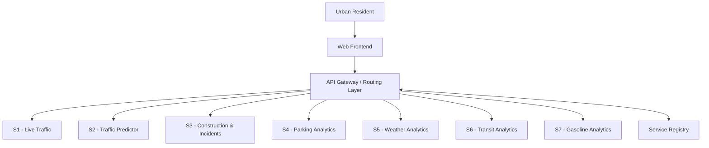

# Smart City Microservices Platform

## 1. Project Overview

The Smart City Microservices Platform is designed to help urban residents understand and navigate city conditions through a unified application.

The platform brings together seven independently developed services covering traffic, incident reporting, parking, weather and air quality, public transit, and gasoline prices. A shared frontend and backend infrastructure provide access to these capabilities.

The system follows a microservices architecture in which each domain service has its own responsibilities, API contract, and implementation.

## 2. Project Objectives

- Provide a unified interface for accessing multiple categories of city information.
- Separate domain capabilities into independently maintainable microservices.
- Define consistent API contracts and service-discovery behaviour.
- Support independent service development, testing, and deployment.
- Evaluate the architecture against the project's functional requirements and Architectural Significant Requirements (ASRs).

## 3. System Components

| Component | Responsibility |
|---|---|
| Frontend | User-facing dashboard and interaction |
| API Gateway / routing layer | Entry point for client requests and backend routing |
| Service Registry | Maintains logical service and instance information for discovery |
| S1 — Live Traffic | Current traffic conditions, congestion, and estimated delays |
| S2 — Traffic Predictor | Historical traffic analysis and future congestion estimates |
| S3 — Construction & Incidents | User-submitted construction and traffic incident reports |
| S4 — Parking Analytics | Parking availability, congestion, and pricing |
| S5 — Weather Analytics | Weather conditions and air-quality information |
| S6 — Transit Analytics | Public-transit information and analysis |
| S7 — Gasoline Analytics | Gasoline prices and station information |

Each service has its own API contract and implementation scope. Refer to the individual service documentation for detailed behaviour.

## 4. High-Level Architecture



This diagram presents the logical platform architecture. It does not represent a complete deployment topology or imply that every request must synchronously query the registry.

For service discovery, routing, deployment, and data ownership details, see the architecture documentation.

## 5. Technology Stack

| Area | Technology / Direction |
|---|---|
| Frontend | Next.js / React |
| Backend services | Python / FastAPI |
| S3 persistence | PostgreSQL with PostGIS |
| Containerization | Docker |
| Cloud platform | Google Cloud Platform |
| Source control | Git and GitHub |

Individual services may use additional technologies and dependencies. Refer to their respective README files and requirements files for implementation details.

## 6. Repository Structure

```text
Smart-City-Microservices/
├── README.md
├── docs/
│   ├── api/
│   │   └── contracts/
│   ├── architecture/
│   └── Testing-*.md
├── frontend/
├── service-registry/
├── services/
│   ├── live-traffic/
│   ├── traffic-predictor/
│   ├── construction-incidents/
│   ├── parking-analytics/
│   ├── weather-analytics/
│   ├── transit-analytics/
│   └── gasoline-analytics/
├── infrastructure/
├── shared/
└── scripts/
```

The repository also contains shared API contracts, Docker Compose configuration, and service-specific tests and configuration.

## 7. Local Development

Local development instructions are maintained in the individual component README files.

For S3 Construction & Incident Reporting, see:

- [S3 Service README](services/construction-incidents/README.md)

The root Docker Compose configuration is used to configure and run the local multi-container environment. Some services may require environment variables or external provider configuration before they can start successfully.

From the repository root:

```powershell
docker compose up --build
```

To validate the Compose configuration before starting containers:

```powershell
docker compose config --quiet
```

Consult the relevant service documentation for required environment variables, ports, dependencies, and service-specific commands.

## 8. Documentation Index

### Architecture

- [System Architecture](docs/architecture/System-Achitecture.md)
- [Service Registry](docs/architecture/Service-Registry.md)
- [Service Data Ownership](docs/architecture/Service-Data-Ownership.md)
- [Deployment Architecture](docs/architecture/Deployment-Architecture.md)
- [Scaling and Routing — T009](docs/architecture/Scaling-and-Routing-T009.md)
- [S3 Construction & Incidents Architecture](docs/architecture/implementations/S3-Construction-Incidents.md)

### API Documentation

- [API Standards](docs/api/API-Standards.md)
- [Service Interfaces and API Contracts](docs/api/Service-Interface.md)
- [S1 — Live Traffic](docs/api/contracts/S1-Live-Traffic.md)
- [S2 — Traffic Predictor](docs/api/contracts/S2-Traffic-Predictor.md)
- [S3 — Construction & Incidents](docs/api/contracts/S3-Construction-Incidents.md)
- [S4 — Parking Analytics](docs/api/contracts/S4-Parking-Analytics.md)
- [S5 — Weather & Air Quality](docs/api/contracts/S5-Weather-Air-Quality.md)
- [S6 — Public Transit](docs/api/contracts/S6-Public-Transit.md)
- [S7 — Gasoline Analytics](docs/api/contracts/S7-Gasoline-Analytics.md)

### Testing and Validation

- [Testing and Validation Overview](docs/Testing-and-Validation.md)
- [S3 — T028–T038 Implementation and Verification](docs/Testing-T028-T038.md)
- [T009, T039, and T041 Verification](docs/Testing-T009-T039-T041.md)
- [T011–T020 Verification](docs/Testing-T011-T020.md)

### Service Documentation

- [S3 — Construction & Incidents](services/construction-incidents/README.md)
- [Service Registry](service-registry/README.md)

## 9. Implementation Status

The platform is developed incrementally across its individual services and shared infrastructure.

S3 Construction & Incident Reporting has implemented its core reporting functionality, including authenticated report submission, geographic retrieval, ownership-based authorization, updates, status transitions, withdrawal, and PostgreSQL/PostGIS persistence.

Its available endpoint and focused validation tests have passed. Final full-suite verification, performance benchmarking, restart-persistence acceptance, and deployment-level integration checks remain outstanding.

Other service and platform capabilities should be assessed using their respective implementation records and test evidence.

A feature should only be described as verified when its required tests or acceptance checks have been completed and the results recorded.