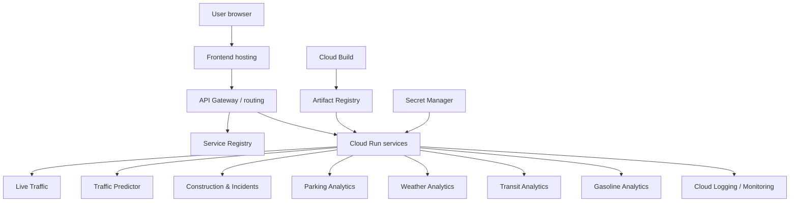

# Deployment Architecture

> **Status:** Initial deployment plan. Replace planned descriptions with the actual Google Cloud resources, service URLs, regions, identities, and deployment evidence once available.

## 1. Purpose

This document records how the Smart City Microservices Platform is packaged, built, configured, deployed, monitored, and operated.

## 2. Deployment Objectives

- Deploy domain services independently.
- Keep configuration separate from source code.
- Use managed infrastructure where appropriate.
- Support repeatable builds and deployments.
- Restrict access using least privilege.
- Collect logs and health information.
- Avoid relying on ephemeral container filesystems for durable shared state.

## 3. Target Deployment View

This is a conceptual target. It does not assert that all resources currently exist or are connected.

## 4. Cloud Environment

Record actual values here:

| Setting | Value |
|---|---|
| Cloud provider | Google Cloud Platform |
| Project ID | `smart-city-platform-514220` (confirm active project before deployment) |
| Region | `northamerica-northeast2` (Toronto) |
| Compute | Cloud Run direction |
| Image registry | Artifact Registry (repository name pending) |
| Build system | Cloud Build |
| Secrets | Secret Manager |
| Logging | Cloud Logging |

Never commit service account keys, credentials, access tokens, or populated `.env` files.

## 5. Containerization

Each deployable backend service should have:

- A reproducible Dockerfile.
- A pinned or controlled dependency set.
- A documented startup command.
- A health/readiness endpoint where appropriate.
- Environment-based configuration.
- A non-root runtime user where practical.
- A `.dockerignore` that excludes virtual environments, caches, local databases, tests where appropriate, and secrets.

Verify the existing Dockerfiles and Compose configuration before changing them.

## 6. Build and Release Flow

Proposed flow:

1. Developer creates a branch and commits code.
2. Pull request triggers automated checks.
3. Tests and static checks run.
4. Cloud Build builds the service image.
5. Image is pushed to Artifact Registry.
6. An authorized deployment step updates the relevant Cloud Run service.
7. Health checks and smoke tests validate the deployment.
8. Rollback procedure is available if validation fails.

Document the actual CI/CD workflow and required approvals once configured.

## 7. Configuration and Secrets

Use environment variables for non-secret configuration.

Use Secret Manager or an approved secret-injection mechanism for secrets.

Document variable names, purpose, required/optional status, and safe example values; never include real secret values.

## 8. Networking and Access Control

Document:

- Public versus private ingress for each service.
- Service-to-service identity and authorization.
- Gateway authentication.
- Registry administrative endpoint protection.
- Egress requirements for external data providers.
- CORS policy for the frontend.
- Network and IAM boundaries.

A service URL being difficult to guess is not access control.

## 9. Scaling and State

Cloud Run can scale service instances and route traffic to a deployed service.

Its stable service URL and platform routing should be distinguished from application-level service discovery.

Do not assume local container files persist across instance replacement or are shared across replicas.

Any shared registry state or durable domain data must use a storage design suitable for the consistency and durability requirements.

## 10. Operations

Record:

- Health and readiness checks.
- Log fields and correlation/request IDs.
- Latency, error-rate, and saturation metrics.
- Alert thresholds and notification destinations.
- Deployment history and rollback steps.
- Backup and restore procedures.
- Cost and quota considerations.

## 11. Deployment Inventory

| Component | Cloud resource name | Region | URL | Status |
|---|---|---|---|---|
| Frontend | Pending | Pending | Pending | Not verified |
| Gateway | Pending | Pending | Pending | Not verified |
| Service Registry | Pending | Pending | Pending | Not verified |
| Live Traffic | Pending | Pending | Pending | Not verified |
| Traffic Predictor | Pending | Pending | Pending | Not verified |
| Construction & Incidents | Pending | Pending | Pending | Not verified |
| Parking Analytics | Pending | Pending | Pending | Not verified |
| Weather Analytics | Pending | Pending | Pending | Not verified |
| Transit Analytics | Pending | Pending | Pending | Not verified |
| Gasoline Analytics | Pending | Pending | Pending | Not verified |