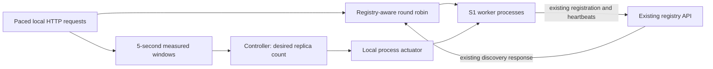

# T009 — Scaling feedback loop and routing policy

Owner: Aaliyan Muhammad. Scope: scaling/routing design and an isolated local prototype.
Implementation: `scripts/scaling/`. This does not implement T087 cloud autoscaling or
replace Henry's consumer/gateway. T039/T041 live in `services/parking-analytics/`.

## Existing architecture inspected

- All seven FastAPI services use `services/shared/registry_client.py`: immediate background
  registration, five-second heartbeats, retry/backoff, re-registration and deregistration.
- Discovery `GET /v1/services/{service_id}` returns healthy, unexpired instance records.
  It returns 503 when none are eligible. Registration/heartbeat/delete require
  `X-Registry-API-Key`; lookup does not. These contracts are unchanged.
- Compose has two registry APIs sharing PostgreSQL, behind HAProxy on host port 8090.
  HAProxy round-robins **registry traffic only**. Neither the registry nor HAProxy creates
  domain-service instances or implements a feedback controller.
- Domain services currently publish fixed host ports (8081–8087). Simply running
  `docker compose up --scale live-traffic=...` causes host-port collisions and is not a
  working autoscaling solution. The prototype leaves this configuration untouched.
- Cloud Run is a documented direction, with no deployment evidence or configured cloud
  autoscaler in the repository. Its stable service URLs must not be confused with
  separately addressable application-managed replicas.

## Control loop and configuration

`policy.json` supplies the following proposed defaults. Capacity is a configurable
starting assumption to benchmark, **not** derived from a measured S1 throughput limit.

| Setting | Default and behavior |
|---|---|
| Scope | One independent controller for logical service `live-traffic` |
| Min/max | 1 / 10 replicas |
| Demand target | 20 admitted original requests/s per ready replica |
| Sampling | Non-overlapping five-second metric windows |
| Scale-out trigger | Demand > replicas × 24 rps (120% of target), or p95 > 2,000 ms with <=10% errors |
| Sustained overload | 10 seconds after first high sample; isolated spikes reset the timer |
| Desired count | `ceil(rps / 20)`, at least current + 1 for latency-only pressure, bounded at 10 |
| Scale-out cooldown | 15 seconds after an action |
| Scale-in | Load <=40% of current capacity, p95 <1,000 ms and zero errors for 120 seconds |
| Scale-in cooldown | At least 60 seconds after an action; remove one replica at a time |
| Incomplete/stale data | No scale-in without latency data; reject stale/future/repeated samples |
| Pending workers | Hold while previously requested workers are not ready; startup timeout 30 s |

At baseline 20 rps, one replica remains. At 200 rps, the proposed capacity model requests
ten replicas. A 20% trigger margin prevents small baseline measurement variations from
starting extra replicas. With a five-second sampling interval and ten-second persistence window,
the first decision is expected within 15 seconds of sustained threshold crossing. This
leaves room inside the ASR5 30-second budget, but does not prove real cloud actuation.

Metrics belong at the routing/admission layer: original requests (including failures),
window duration, end-to-end p95 and error fraction. Retries must not count as new arrivals.
The prototype measures these from its paced HTTP client and includes failures in latency
samples. It does not observe real users or external requests outside that harness.
Production monitoring should also record ready/starting/draining counts, per-instance
CPU/memory, queue depth and startup/registration times. Those resource metrics are not
implemented here. Sustained high errors suppress latency-only expansion so dependency
outages do not alone trigger an endless scale-out; demand can still reach the configured cap.

## Actuation, discovery and load distribution

The local actuator launches the **unmodified S1 starter** using the same Python environment
and unique loopback ports. It sets `REGISTRY_ADVERTISED_ENDPOINT`, `REGISTRY_URL` and the
registry key. It waits for health and an actual discovery record before counting a worker
ready. Startup failures abort the demo and clean up owned processes; they do not report
desired replicas as ready. The policy can also hold explicit pending-replica state; a
production actuator must reconcile observed state after a failed action before retrying.

The harness refreshes discovery before each workload window and after each worker starts.
It uses equal-weight round robin across healthy, unexpired instances. Lease validity is
checked for every selection, including cached records. A newly discovered instance joins
the rotation without restarting consumers. A failed idempotent GET may be retried once
on a different eligible instance. There is no retry of arbitrary writes. The router is
single-process demo code, not a general gateway, distributed scheduler or circuit breaker.

For scale-in, mark the chosen instance draining, stop assigning new calls, allow existing
calls to finish, deregister using the existing authenticated DELETE, then terminate it.
The harness actuates between fully awaited request batches, so no requests are in flight.
A workload pause during that local actuation is excluded from its request-latency samples;
the short harness is not a continuous peak-load benchmark.
A production gateway needs shared drain coordination and a bounded shutdown timeout.
Unexpected worker crashes are filtered through existing heartbeat/lease expiry and bounded
request failure handling; instantaneous crash detection is not claimed.

Keep domain handlers stateless across replicas: no local sessions, authoritative occupancy,
or per-process counters used as shared data. T039/T041 recompute from supplied observations
or immutable fixtures. Future live caches must share a timestamped snapshot or consume the
same approved event stream. Registry PostgreSQL stores registry state only; it is not a
shared domain-service database. This prototype uses temporary single-process SQLite.

## Deployment strategy and unfinished integration

For Compose-managed scaling, a later opt-in topology must remove fixed worker host-port
bindings, advertise addresses of individual reachable workers, add a domain router and
an actuator with narrowly scoped orchestration access. Registry records pointing every
replica at the same service DNS name would obscure per-instance selection. No Docker
socket is mounted and no shared Compose/HAProxy configuration is changed in this task.

If the team selects Cloud Run's native autoscaling, validate its supported metrics,
min/max settings, startup time and routing separately. Discover a stable service URL;
let Cloud Run route its private replicas. Do not run this process actuator in production
or claim that the registry enumerates private Cloud Run instances. T087 owns deployed
autoscaling; T007/T073 own consumer routing integration; T008 owns shared payload contracts.

## ASR5 evidence boundaries

| Target | Evidence provided by T009 | Still required |
|---|---|---|
| 20 rps normal / 200 rps peak | Automated policy tests and virtual-time input scenario | Representative deployed S1 analytics load |
| Scale-out starts within 30 s | Deterministic decision test; measured local prototype logs | Repeated platform tests from actual threshold crossing |
| New workers serve within 60 s | Local logs measure launch-to-discovery; routed instance counts show service | Deployed launch-to-first-request measurement under peak load |
| 95% of responses within 2 s after scaling | Harness reports measured root-endpoint p95/errors | Real analytics dataset, agreed load/concurrency, post-scale measurements |

`simulate.py` explicitly assumes immediate actuation and synthetic latency. It verifies
policy behavior only. `local_demo.py` actually starts workers, performs registry lookups
and sends HTTP requests, but exercises the starter root endpoint. Neither establishes
ASR5 acceptance for traffic analytics or high-availability registry behavior. See
`scripts/scaling/README.md` for exact commands and the recorded verification results.
