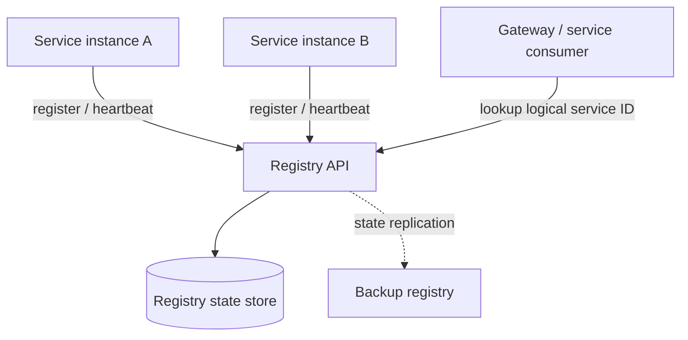

# Service Registry — Design, Implementation, and Verification

> **Task association:** T006 — Design discovery registry and instance contracts  
> **Status:** Consolidated working document. Do not mark a capability implemented or verified until code and test evidence are recorded.

## 1. Purpose

The Service Registry provides a logical directory of backend services and their available instances.

A consumer identifies a service by a stable logical ID and obtains endpoint information without hard-coding an instance address.

The registry supports the architecture's discovery requirements. It does not replace Cloud Run's management and load balancing of Cloud Run replicas.

## 2. Terminology

| Term | Meaning |
|---|---|
| Logical service ID | Stable identifier for a capability, e.g. `live-traffic` |
| Instance ID | Unique identifier for one registered instance |
| Endpoint | Network address used by a consumer to reach an instance or stable service endpoint |
| Registration | Operation that adds or refreshes an instance record |
| Heartbeat | Periodic lease renewal indicating that an instance is alive |
| Deregistration | Explicit removal or withdrawal of an instance |
| Expiration | Marking an instance unavailable after its lease expires |
| Failover | Switching registry operation to a backup after primary failure |
| Replication | Sharing registry state between registry nodes |

## 3. Conceptual Architecture



This is a conceptual target. The actual implementation may differ.

In particular, a single-process SQLite implementation is not replicated state and does not by itself provide primary/backup failover.

## 4. Logical Service and Instance Model

Each instance record should contain, at minimum:

| Field | Purpose |
|---|---|
| `service_id` | Logical service identity |
| `instance_id` | Unique instance identity |
| `endpoint` | Consumer-facing endpoint |
| `status` | Health/availability state |
| `registered_at` | Registration timestamp |
| `last_heartbeat` | Most recent successful lease renewal |
| `lease_expires_at` | Time after which the instance is considered expired |
| `version` | Optional service version |
| `metadata` | Non-sensitive descriptive attributes, if needed |

Define uniqueness constraints.

An instance ID must not silently change ownership from one logical service to another.

Specify whether the endpoint represents a private instance address, a stable platform URL, or another routing target.

## 5. Registration Contract

**Proposed operation:** `POST /v1/instances/register`

Example request (illustrative; align with the implemented Pydantic schema):

```json
{
  "service_id": "live-traffic",
  "instance_id": "live-traffic-a1",
  "endpoint": "https://example-service.example",
  "version": "1.0.0",
  "metadata": {
    "region": "northamerica-northeast2"
  }
}
```

Expected behaviour:

- Validate the logical service ID, instance ID, endpoint, and metadata.
- Create a new instance record or apply a documented idempotent update.
- Return the resulting registration record.
- Reject conflicting identity changes.
- Require authentication/authorization before accepting registrations in a deployed environment.

## 6. Discovery Contract

**Proposed operation:** `GET /v1/services/{service_id}`

A lookup should return the logical service ID and the set of currently eligible instances.

Define ordering or selection behaviour, such as round-robin, random selection, or returning all eligible instances for the consumer to select.

Example response (illustrative):

```json
{
  "service_id": "live-traffic",
  "instances": [
    {
      "instance_id": "live-traffic-a1",
      "endpoint": "https://example-service.example",
      "status": "healthy"
    }
  ]
}
```

The consumer must handle an empty result, registry timeout, stale discovery data, and an endpoint becoming unavailable after lookup.

## 7. Heartbeat and Lease Expiry

**Proposed operation:** `POST /v1/instances/{instance_id}/heartbeat`

A heartbeat renews an instance lease.

The design discussed for PR1 uses a 5-second heartbeat interval, three missed heartbeats, and removal/unavailability within 15 seconds.

Confirm the exact acceptance wording and whether the 15-second target is measured from the last heartbeat or from the first missed heartbeat.

Specify:

- Whether a late heartbeat can revive an expired instance.
- Whether the registry returns the updated lease expiry.
- How clock skew is handled.
- Whether expiry means soft-unavailable status or physical deletion.
- How concurrent heartbeat and deregistration requests are serialized.

## 8. Deregistration

**Proposed operation:** `DELETE /v1/instances/{instance_id}`

Deregistration should be idempotent or return a clearly documented not-found response.

A withdrawn instance must no longer be returned as eligible for new discovery requests.

## 9. Multiple Instances

A logical service may have multiple instance records.

Discovery must return only eligible instances, and consumers must define how they select an endpoint.

Avoid treating each instance as a separate logical service.

## 10. Replication and Failover

The PR1 requirements discussed for this project include:

- Registry primary failure detection within 6 seconds, using 2-second probes.
- Backup serving searches within 10 seconds.
- Retry/recovery behaviour for in-flight discovery.
- Registration state shared/replicated within 2 seconds.
- Registrations older than 2 seconds available after failover, with newer registrations recovered through the next heartbeat within 5 seconds.

These are target requirements to verify against the original PR1 workbook. They are **not claims that failover or replication is implemented**.

A design must identify:

- Primary/backup election or fixed-role model.
- Shared or replicated storage mechanism.
- Consistency and conflict resolution.
- Split-brain prevention.
- Health-check and promotion procedure.
- Client retry and timeout policy.
- Recovery and re-synchronization behaviour.

A local SQLite database on each registry container is not a replication strategy. Multiple Cloud Run instances with separate local files do not share a consistent registry.

## 11. API Summary

| Method | Path | Purpose |
|---|---|---|
| `GET` | `/health` | Liveness check |
| `GET` | `/ready` | Readiness check |
| `POST` | `/v1/instances/register` | Register an instance |
| `POST` | `/v1/instances/{instance_id}/heartbeat` | Renew instance lease |
| `DELETE` | `/v1/instances/{instance_id}` | Deregister an instance |
| `GET` | `/v1/services` | List logical services |
| `GET` | `/v1/services/{service_id}` | Discover instances for a service |

This table reflects the proposed starter API. Confirm paths and response schemas against the actual application before publishing as an implemented contract.

## 12. Implementation Record

| Area | Actual implementation | Status / evidence |
|---|---|---|
| API framework | To be confirmed | Pending |
| Persistence | To be confirmed | Pending |
| Registration | To be confirmed | Pending |
| Discovery | To be confirmed | Pending |
| Heartbeat / expiry | To be confirmed | Pending |
| Multiple instances | To be confirmed | Pending |
| Authentication | To be confirmed | Pending |
| Replication | To be confirmed | Pending |
| Failover | To be confirmed | Pending |

## 13. Verification and Acceptance Evidence

| Requirement | Target (verify against source workbook) | Test method | Actual result |
|---|---|---|---|
| ASR1 — registration/search | Registration and search within 5 seconds without restart | Register while service is running; measure visibility and confirm no restart | Not yet recorded |
| ASR2 — heartbeat/expiry | 5-second heartbeat; 3 missed heartbeats; unavailable within 15 seconds | Stop heartbeat and measure time to unavailable state | Not yet recorded |
| ASR3 — failover | Detect primary failure within 6 seconds; backup serves search within 10 seconds | Stop primary; measure detection and successful backup lookup | Not yet recorded |
| ASR4 — replication | State shared within 2 seconds; recovery rules per requirement | Register instances, inspect backup state, fail over, compare records | Not yet recorded |
| ASR5 — multiple instances | Multiple endpoints per logical service | Register two or more instances and verify lookup | Not yet recorded |

For each test, record test date, commit, environment, command or procedure, expected result, actual result, and evidence location.

Do not enter pass results without evidence.

## 14. Security and Operational Considerations

- Protect registration, heartbeat, and deregistration endpoints with service authentication.
- Do not expose administrative registry endpoints publicly without authorization.
- Validate endpoint schemes and destinations. If the registry or gateway probes registered endpoints, enforce a trusted-host policy to reduce SSRF risk.
- Do not allow sensitive credentials in metadata.
- Define retention/cleanup for expired records.
- Add structured logs and metrics for registration, lookup, lease expiry, and failover.
- Define backup, restore, and data migration procedures.

## 15. Known Limitations and Outstanding Decisions

Complete this section as implementation proceeds.

At minimum, assess persistence durability, multi-process consistency, authentication, heartbeat recovery semantics, instance identity constraints, real-time expiry testing, replication, and failover.

A successful local unit-test run does not establish the ASR3/ASR4 failover and replication requirements.