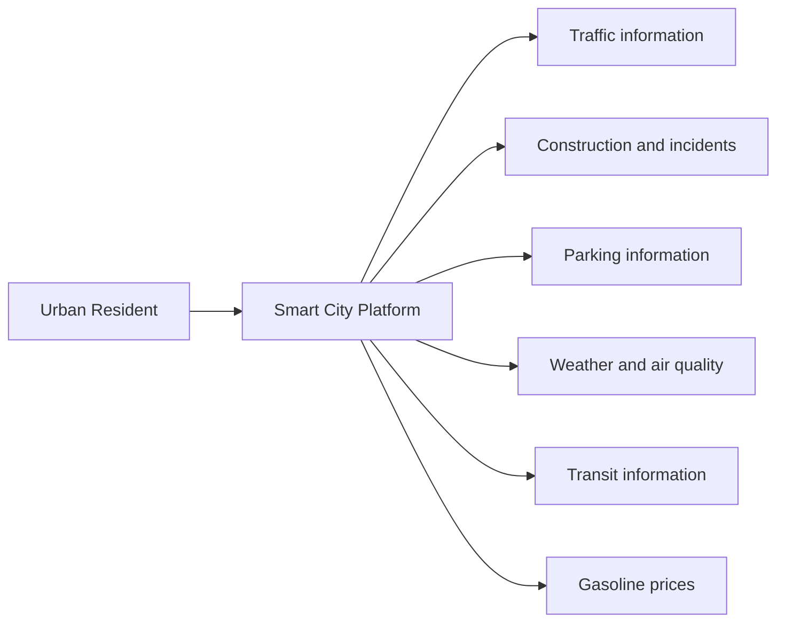
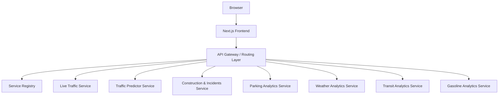

# System Architecture

> **Status:** Initial architecture baseline. Update this document when the team approves the architecture and as implementation decisions are made.

## 1. Purpose and Scope

This document describes the overall architecture of the Smart City Microservices Platform: its major components, responsibilities, communication relationships, and quality attributes.

It is a system-level view; detailed service contracts, registry behaviour, and deployment topology are documented separately.

## 2. Architectural Style

The system uses a microservices-oriented architecture. Domain capabilities are separated into independently developed and deployable backend services.

The frontend communicates through a backend entry/routing layer rather than depending directly on each service's internal implementation.

The architecture aims for:

- **Separation of concerns:** Each service owns a defined domain capability.
- **Loose coupling:** Services communicate through explicit interfaces.
- **Independent deployment:** A service can be built and deployed without rebuilding every other service, subject to shared-contract compatibility.
- **Discoverability:** Consumers use logical service identities rather than embedding transient instance addresses.
- **Observability:** Service health, request outcomes, and failures can be diagnosed.
- **Security:** Service-to-service and client access are controlled; management endpoints are not exposed without authorization.

## 3. System Context

External data providers and data acquisition mechanisms are not specified here.

Document each provider, licence, update frequency, and failure mode when selected.

## 4. Component View

The registry supplies discovery metadata to the routing layer or service consumers.

The registry is not itself the data-processing service for city information.

## 5. Component Responsibilities

| Component | Responsibility | Must not become responsible for |
|---|---|---|
| Frontend | Presentation, user input, visualizations | Owning backend service data logic |
| Gateway / routing | Request entry, routing, cross-cutting access controls | Implementing every domain's business logic |
| Registry | Logical service and instance records, leases/health state, lookup | Replacing cloud infrastructure's replica load balancing |
| Domain service | Its domain-specific API and processing | Managing unrelated service domains |

### Domain Services

1. **Live Traffic:** Current traffic conditions, congestion, and delays.
2. **Traffic Predictor:** Estimates future traffic from historical and other approved inputs.
3. **Construction & Incidents:** Reports construction and traffic incidents.
4. **Parking Analytics:** Parking availability, congestion, and pricing.
5. **Weather Analytics:** Weather and air-quality measures and trends.
6. **Transit Analytics:** Public-transit information and analysis.
7. **Gasoline Analytics:** Station and fuel-price information.

These are intended scopes. Confirm the precise data and operations in each service's API contract.

## 6. Communication Model

The frontend sends requests to the backend entry point.

The gateway routes a request to the appropriate logical service. Service discovery resolves a logical service identifier to one or more usable instance endpoints.

The team must specify:

- HTTP methods, paths, payloads, and response formats.
- Request timeouts and retry rules.
- Whether calls are synchronous or asynchronous.
- Discovery caching and refresh behaviour.
- Error propagation and fallback behaviour.
- Authentication and authorization between components.

Do not retry non-idempotent operations automatically unless the API defines an idempotency mechanism.

## 7. Scaling and Availability

Domain services should be independently scalable where workload differences justify it.

If deployed on Cloud Run, Cloud Run manages the lifecycle and routing of service revisions/instances behind a stable service URL.

The application-level registry has a different purpose: resolving logical service identities and maintaining application-defined instance metadata where required.

Do not assume the registry can enumerate private Cloud Run replicas or replace Cloud Run's load balancing.

The deployment design must decide whether consumers discover stable Cloud Run service URLs or individual application-managed instances.

## 8. Security Considerations

- Authenticate and authorize client-facing and administrative operations.
- Protect registry registration, heartbeat, and deregistration operations.
- Use least-privilege service identities.
- Store secrets outside source control.
- Validate inputs and enforce request size limits.
- Avoid blindly probing arbitrary URLs supplied during registration; this can create server-side request forgery (SSRF) risks.
- Use TLS for network traffic where supported.
- Avoid logging credentials, tokens, or sensitive personal data.

## 9. Architecture Decisions to Record

| Decision | Current position | Evidence / owner / date |
|---|---|---|
| Service boundaries | Seven domain services listed above | Confirm with team |
| Backend framework | FastAPI direction | Confirm versions |
| Frontend framework | Next.js direction | Confirm version |
| Deployment platform | Google Cloud / Cloud Run direction | Record actual deployed resources |
| Discovery model | Logical registry plus deployment-level routing | Resolve exact consumer/discovery flow |
| Registry persistence and replication | Not yet verified | Must be designed and tested |

## 10. Open Questions

- Is the API Gateway a separately deployed component or routing code in the frontend/backend?
- Which services call the registry, and how is discovery cached?
- Which service owns each external data integration?
- What persistence technology is used by each service?
- What is the agreed authentication model?
- Which availability and performance targets are acceptance criteria?