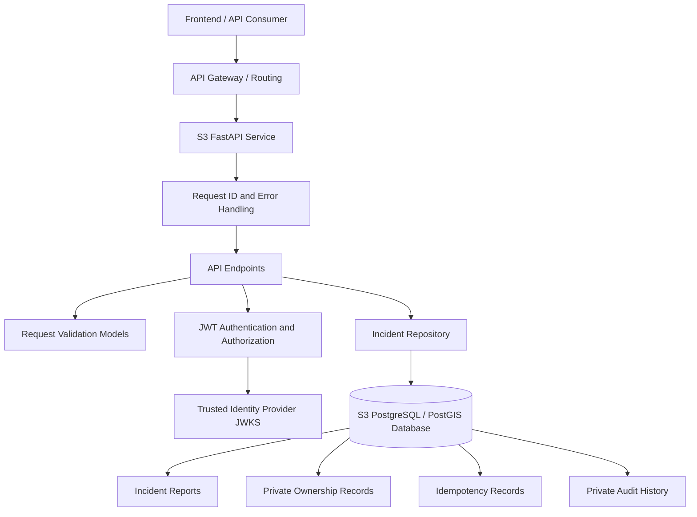

# S3 — Construction & Incident Reporting Architecture

> **Status:** Implemented service architecture. Production identity-provider configuration, deployment integration, and full acceptance verification remain outstanding.

## 1. Purpose and Scope

This document describes the internal architecture of S3, the Construction & Incident Reporting microservice.

S3 allows users to submit construction and traffic incident reports, search for reports geographically, retrieve report details, update reports, and withdraw reports.

The service is independently implemented using FastAPI and owns its report persistence through a dedicated PostgreSQL/PostGIS database.

This document describes the implemented service design. API request and response requirements are defined separately in `docs/api/contracts/S3-Construction-Incidents.md`.

## 2. Architectural Overview

S3 follows a resource-server architecture.

The service receives HTTP requests, validates request data, verifies authentication where required, applies authorization rules, and delegates persistence operations to its repository layer.

The API Gateway provides the platform entry point and routes requests to S3. S3 remains responsible for its own domain validation, authentication checks, authorization, and persistence.

## 3. Component Responsibilities

| Component | Responsibility |
|---|---|
| FastAPI application | Creates the application, manages lifecycle, and exposes HTTP endpoints |
| Request middleware | Assigns or validates request IDs and supports consistent error handling |
| Request models | Validates request fields, geographic coordinates, timestamps, and query parameters |
| Authentication module | Verifies RS256 JWTs against trusted signing keys and expected claims |
| Authorization logic | Enforces report ownership and moderator permissions |
| Repository | Implements database operations, status transitions, idempotency, and audit persistence |
| Database manager | Manages PostgreSQL connections and initializes the required schema |
| PostgreSQL/PostGIS | Stores incident reports and supports geographic queries |
| Registry client | Supports optional service registration and lifecycle integration |

## 4. Request Processing

### 4.1 Public read requests

The following operations are publicly accessible:

- `GET /v1/incidents`
- `GET /v1/incidents/{incident_id}`

A geographic search request follows this flow:

1. The request reaches the FastAPI application.
2. Query parameters are validated.
3. Latitude, longitude, radius, filters, sorting, and pagination are checked.
4. The repository performs a geographic database query using PostGIS.
5. Results are filtered, sorted, and paginated.
6. Public response models serialize the results.
7. The response includes freshness and provenance metadata.

The list endpoint returns summary information and does not expose report descriptions or private ownership information.

The detail endpoint returns the full public report representation. Withdrawn reports are not publicly retrievable.

### 4.2 Authenticated write requests

The following operations require authenticated users:

- `POST /v1/incidents`
- `PATCH /v1/incidents/{incident_id}`
- `DELETE /v1/incidents/{incident_id}`

Write requests follow this flow:

1. The request reaches the FastAPI application.
2. The authentication layer extracts the bearer token.
3. The token verifier validates the signature and required claims.
4. The verified subject is used as the requester's identity.
5. Request data is validated against the applicable Pydantic model.
6. Authorization rules are applied where report ownership or moderator permissions are required.
7. The repository performs the appropriate database transaction.
8. A public response is returned without exposing private ownership or audit information.

Authentication and authorization are enforced by S3 rather than relying exclusively on the API Gateway.

## 5. Authentication and Authorization

### 5.1 JWT verification

S3 acts as a resource server and does not issue tokens or establish user identities.

The authentication module verifies RS256-signed JWTs using a configured JSON Web Key Set (JWKS) endpoint.

The verifier checks:

- Token signature.
- Expected issuer.
- Expected audience.
- Expiration.
- Issued-at time.
- Required subject claim.

The verified subject (`sub`) identifies the requester.

Role claims are read only from successfully verified tokens.

### 5.2 Configuration

The following environment variables configure the verifier:

| Environment variable | Purpose |
|---|---|
| `JWT_ISSUER` | Expected token issuer |
| `JWT_AUDIENCE` | Expected token audience |
| `JWT_JWKS_URL` | Trusted JWKS endpoint |
| `JWT_ROLE_CLAIM` | Role claim name; defaults to `roles` |
| `JWT_MODERATOR_ROLE` | Moderator role; defaults to `moderator` |

The production identity provider, issuer, audience, and final claim conventions must be confirmed before deployment.

### 5.3 Authorization rules

| Operation | Authorization |
|---|---|
| Search reports | Public |
| Retrieve report details | Public |
| Create report | Any authenticated and verified user |
| Update report | Verified owner or moderator |
| Withdraw report | Verified owner or moderator |

The ownership relationship is established using the verified token subject. A client cannot choose or overwrite the report owner through request fields.

Moderator privileges are derived from verified role claims rather than client-supplied values.

## 6. Database Architecture

### 6.1 Database ownership

S3 owns a dedicated PostgreSQL database with PostGIS support.

The local Docker Compose database service is named:

`incidents-postgres`

The database is separate from the Service Registry database. S3 does not store incident reports in the Registry's persistence layer.

The application connects through its configured `INCIDENTS_DATABASE_URL`.

### 6.2 Persistent data

The database stores the following logical records:

| Record | Purpose |
|---|---|
| Incident reports | Report content, location, category, status, and timestamps |
| Private ownership records | Verified owner association for authorization |
| Idempotency records | Request fingerprints and original creation results |
| Audit records | Private history of report changes and status transitions |

The database manager initializes the required schema, including PostGIS support.

### 6.3 Geographic queries

Incident locations use WGS 84 geographic coordinates.

PostGIS supports radius-based geographic searches without requiring the application to load every report into memory.

The repository applies geographic filtering, additional report filters, sorting, and pagination as part of the database query.

### 6.4 Transactional behaviour

Database transactions protect operations that modify report state.

For report creation, the report and associated private ownership and idempotency information must be durably committed before the service returns a successful `201` response.

Updates and withdrawals are performed through repository operations that maintain the report state and associated audit history atomically.

### 6.5 Data lifecycle

Reports begin with the `active` status.

Permitted status transitions are enforced by the repository and API validation rules.

Withdrawal is a soft deletion. The report status changes to `withdrawn`, public reads stop revealing the report, and private records remain available subject to the eventual retention and privacy policy.

The seven-day stale indicator for active reports is a review-age signal. It does not automatically delete or withdraw reports.

## 7. Idempotency

Report creation uses the `Idempotency-Key` request header.

The key is scoped to the verified user and create operation.

The service retains idempotency records for 24 hours.

The expected behaviour is:

| Situation | Behaviour |
|---|---|
| Same key and same canonical request payload | Return the original creation result |
| Same key and different request payload | Return `409 IDEMPOTENCY_KEY_CONFLICT` |
| Different keys | Treat as separate creation requests |

This prevents a client retry from accidentally creating another report when the original response was lost.

## 8. Error Handling and Request Tracing

S3 uses a consistent error response envelope containing:

- Error code.
- Human-readable message.
- Request ID.
- Error details.
- Retryability indicator.
- Error source.

Request IDs are used to correlate requests and application logs.

Expected request and domain errors are converted into the documented HTTP responses. Unexpected internal errors are logged without exposing sensitive implementation details to API consumers.

Important status codes include:

| HTTP status | Meaning |
|---|---|
| `400` | Malformed request |
| `401` | Missing or invalid authentication |
| `403` | Authenticated requester is unauthorized |
| `404` | Report not found or not publicly visible |
| `409` | Resource or idempotency conflict |
| `422` | Request validation failure |
| `500` | Unexpected internal error |
| `503` | Required dependency unavailable |

## 9. Health and Readiness

S3 exposes separate health and readiness endpoints.

| Endpoint | Purpose | Expected behaviour |
|---|---|---|
| `GET /health` | Liveness | Returns healthy when the application process is running |
| `GET /ready` | Readiness | Returns ready only when the database and trusted token-verification dependency are available |

A database failure or unavailable required token-verification dependency causes readiness to return `503 SERVICE_UNAVAILABLE`.

Liveness is intentionally separate from readiness so that a temporary dependency failure does not necessarily mean the application process itself has stopped.

## 10. Deployment Architecture

S3 is containerized and can be run through Docker Compose alongside its dedicated PostgreSQL/PostGIS database.

The service listens on port `8080` inside its container and is exposed on port `8083` for local development.

The Docker image installs the service dependencies and includes the shared platform code required by the application.

Configuration and secrets are supplied through environment variables rather than hard-coded into the application.

The local database uses a persistent Docker volume so that report data survives ordinary container restarts.

Production deployment still requires:

- Provisioning a production PostgreSQL/PostGIS instance.
- Configuring the trusted identity provider.
- Securely supplying database and JWT configuration.
- Establishing database backup and recovery procedures.
- Confirming network access and service identity.
- Verifying gateway routing and production readiness.

## 11. Security and Privacy Considerations

S3 accepts user-submitted reports and stores a private association between each report and its verified owner.

Security controls include:

- JWT signature and claim verification.
- Server-derived ownership identity.
- Owner/moderator authorization.
- Strict request model validation.
- Rejection of client-supplied ownership and server-managed fields.
- Exclusion of private owner identifiers and audit history from public responses.
- Soft withdrawal rather than public deletion of historical records.
- Safe error responses that do not expose internal details.

An incident report represents a user-submitted assertion. Its content is not automatically verified by an external authority.

A formal retention and privacy policy must be approved before production collection of user-submitted personal information.

## 12. Related Documentation

| Document | Purpose |
|---|---|
| `services/construction-incidents/README.md` | Service setup and usage |
| `docs/api/contracts/S3-Construction-Incidents.md` | S3 API contract |
| `shared/api-contracts/s3-construction-incidents.openapi.yaml` | Machine-readable OpenAPI definition |
| `docs/architecture/Service-Data-Ownership.md` | Domain data ownership across services |
| `docs/architecture/Deployment-Architecture.md` | Platform deployment design |
| `docs/Testing-T028-T038.md` | S3 implementation and verification evidence |

## 13. Outstanding Architecture and Deployment Work

The core S3 service architecture is implemented. The following items remain to be confirmed or verified:

- Production identity provider and JWT claim conventions.
- Approved retention and privacy policy.
- Production database provisioning and backup/recovery.
- Gateway and frontend integration.
- Representative performance and concurrency acceptance tests.
- Production deployment and readiness verification.
