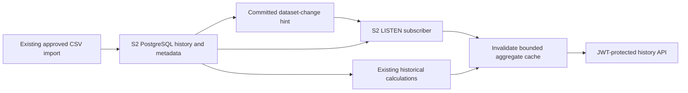

# S2 T010 — ingestion, pub/sub, caching and stale-data handling

This implementation builds on T008's S2 rules. It completes the S2 integration
described below; it does not claim the platform-wide T010 work for S1–S7 is complete.
The S2 authentication commit remains separate in Git history.

## T008 requirements and implementation

| T008 source | S2 requirement | Implementation/evidence |
|---|---|---|
| [Data ownership §4.2](../../docs/architecture/Service-Data-Ownership.md#42-s2--traffic-predictor) | Own imported history, versioned models and lineage; use published interfaces for any S1 export | Existing S2 PostgreSQL tables/importer and prediction gates preserved. No access to another service's tables or raw user traces. |
| [Dependency register §4](../../docs/architecture/External-Data-Dependencies.md) | Normalize times/locations, preserve source and refresh dates, periodically load approved history | Existing Toronto importer plus normalized CSV reader; source validation; configurable metadata/file reconciliation. This does not approve a new provider. |
| [Ownership §7](../../docs/architecture/Service-Data-Ownership.md#7-storage-selection-deployment-and-isolation) | Idempotent refresh/consumers; no contradictory replica projections | Transactional dataset-update publication, revision-based invalidation and repeatable reconciliation; tested with two independent consumers. |
| [S2 contract §5.2](../../docs/api/contracts/S2-Traffic-Predictor.md#52-model-and-data-lifecycle) | Historical freshness is distinct from retention; expired models cannot serve new forecasts | Original dataset dates retained on cache hits/fallback, stale flags recomputed; forecast outputs remain uncached and retain existing approval/expiry gates. |
| [Common standards](../../docs/api/API-Standards.md) | Finite timeouts, bounded retries, truthful availability and protected operations | Background reconnect with bounded jitter, limited aggregate cache, 503 for uncached outages, existing JWT checks on history and operational status. |

T008 leaves broker products, exact historical refresh cadence and retention policy
to implementation/deployment design. PostgreSQL notification hints reuse S2's own
database. The default settings below are explicit S2 operational choices, not claims
that T008 specified their numerical values or that a vendor publishes at that rate.



## Ingestion and event contract

The existing `import_toronto_midblock.py` still validates and imports the historical
dataset. After a successful import, `record_import_metadata` writes the actual local
sync time, refresh deadline and latest observed time. It publishes a parameterized
`pg_notify` in that same metadata transaction, so a rolled-back transaction cannot
announce a committed metadata revision.

Channel: **`s2_dataset_updated_v1`**, scoped to the **S2-owned database**. Payload:

```json
{
  "schema_version": 1,
  "dataset_id": "toronto_midblock_2025_2029",
  "dataset_updated_at": "2026-11-12T18:00:00Z",
  "dataset_refresh_due_at": "2027-02-10T18:00:00Z",
  "latest_observation_at": "2026-11-09T13:15:00Z"
}
```

Dates above are illustrative. The real publisher uses actual importer metadata;
`dataset_updated_at` is S2's successful sync time, not a fabricated provider timestamp.
The latest observation remains separate. No observations, credentials or private
user identifiers are transmitted in the notification.

Subscribers validate version/shape and expected dataset ID, then reload authoritative
metadata. Notifications are hints and can be lost while disconnected. Initial,
periodic and reconnect reconciliation recover the current state without a durable
queue. Repeated notifications do not duplicate historical rows or invalidate a cache
again when the metadata revision is unchanged. Stale/out-of-order hints cannot roll
the metadata back because the database is reread. Access is governed by S2 database
credentials; this is not an open cross-service feed or S1 ingestion contract.

CSV mode reloads only normalized road-history files. Changed files are validated and
replaced as a snapshot. Empty, malformed, future-dated or changing-during-read inputs
retain the last usable snapshot and mark affected responses stale. A content digest
detects changed records even if source metadata dates were left unchanged; the digest
is a version identifier and does not manufacture a new timestamp.

## Aggregate-cache and failure policy

- Historical aggregation is reused for identical requests with explicit start/end
  instants, including location, timezone, filters, sorting and pagination in the key.
- Queries with relative/default windows bypass the result cache; the requested
  interval is not silently replaced by an earlier interval.
- Successful source reads populate an LRU cache bounded by entry count, retention
  and a 64-KiB serialized-response limit. It stores only derived historical responses.
- The default cache is in memory. An optional service-owned SQLite cache preserves
  previously computed aggregates after restart; it is disposable, not the historical
  business database. Use a separate cache path per instance. An unusable persistent
  cache falls back to memory without replacing the damaged file.
- New metadata revisions invalidate fresh-cache eligibility. An in-flight old
  computation cannot warm the cache after an invalidation.
- On a source/database outage, only a matching retained query may fall back.
  `is_stale` is true, `is_live` remains false and `data_status` stays `historical`.
  Source update/refresh dates are unchanged. Cache reads never extend retention.
- A missing/expired cache entry returns the existing 503 error during an outage.
  Coverage/validation failures do not receive unrelated cached results.
- `as_of` is the current processing time. `X-S2-Cache` reports `HIT`, `MISS`,
  `BYPASS` or `STALE`; a cache hit may still be stale because the dataset refresh
  deadline passed. A cache TTL is not a provider freshness guarantee.
- Prediction calculations are unchanged. Historical fallback never approves a model,
  supplies a fake forecast or extends `model_valid_until`.

`GET /v1/traffic/ingestion/status` requires the same verified bearer token as S2
analytics. It reports source availability, last successful check, dataset metadata,
subscriber connectivity, event counts and cache statistics. It omits file paths,
connection strings, credentials and records. Source failure does not fail `/health`.
The existing S2 readiness policy continues to recognize its historical workload;
individual prediction endpoints still reject missing/expired/unapproved models.

## Settings

| Variable | Default | Meaning |
|---|---|---|
| `S2_REFRESH_SECONDS` | `5` | Metadata/file reconciliation; 0.1–3600 seconds |
| `S2_RETRY_MAX_SECONDS` | `60` | Maximum reconnect delay; at least the refresh interval, at most 3600 seconds |
| `S2_CACHE_TTL_SECONDS` | `30` | Fresh-query reuse; nonnegative and no longer than retention |
| `S2_CACHE_RETENTION_SECONDS` | `86400` | Maximum aggregate fallback age since computation; at most seven days |
| `S2_CACHE_MAX_ENTRIES` | `128` | LRU limit, 1–4096 entries |
| `S2_CACHE_PATH` | unset | Optional S2-only SQLite path; memory cache otherwise |

The subscriber uses a 2-second connection timeout, a 2-second metadata-statement
timeout and short interruptible notification waits. Reconnect uses capped exponential
backoff with jitter. Existing historical/prediction SQL timeouts remain as implemented
by their adapters. Source publication cadence, source refresh deadline, reconciliation
interval, cache TTL and retention are distinct.

## Run and demonstrate

Keep the existing real-database import and model setup in [S2_README](S2_README.md)
and the JWT setup in [AUTHENTICATION](AUTHENTICATION.md). Starting the API now starts
the dataset monitor automatically. No new broker installation or runtime dependency
is needed. Psycopg's minimum becomes 3.2.4 for its bounded notification API.

In the authenticated caller terminal:

```powershell
$headers = @{ Authorization = "Bearer $env:S2_ACCESS_TOKEN" }
$query = 'latitude=43.736355&longitude=-79.43891&timezone=America%2FToronto&day_of_week=monday&local_hour=8&start_at=2026-11-01T00%3A00%3A00Z&end_at=2026-11-10T00%3A00%3A00Z'
Invoke-WebRequest "http://localhost:8082/v1/traffic/history/patterns?$query" -Headers $headers -UseBasicParsing
Invoke-WebRequest "http://localhost:8082/v1/traffic/history/patterns?$query" -Headers $headers -UseBasicParsing
Invoke-RestMethod 'http://localhost:8082/v1/traffic/ingestion/status' -Headers $headers | ConvertTo-Json -Depth 5
```

Use a location/date interval covered by your imported dataset. The first response
reports `MISS`, the next identical request within TTL reports `HIT`. A successful
reimport publishes an update and invalidates caches. To demonstrate a database outage,
use the isolated verification command below; it never stops your team's database.

For Docker, the optional S2-only overlay adds S2 database wiring and a disposable
cache volume. Populate root `.env` as usual, set a URL-safe `S2_DB_PASSWORD`, and use
the same project name/password consistently:

```powershell
docker compose -f docker-compose.yml -f docker-compose.s2-db.yml -f services/traffic-predictor/compose.ingestion.yml up --build -d traffic-predictor
```

This starts S2, its own database and registry dependencies. Start/configure the team's
Keycloak as described in AUTHENTICATION.md; root Compose does not import its realm.
Import data into this S2 database before expecting history readiness. A new volume
starts empty; the API does not seed simulated observations into the real database.

## Reproducible verification

Verified locally November 12, 2026 (America/Toronto):

- **137 S2 tests passed**, including the existing estimator/model/history checks,
  JWT enforcement, status-schema conformance, cache boundaries/races, refresh,
  validation, bounded retention and restart recovery.
- [PostgreSQL evidence](ingestion-verification.json): two independent consumers
  received committed updates and invalidated their caches; duplicate/malformed
  events, metadata-only changes, missed-update recovery, outage and persistent
  fallback all passed. Seventy-five cached function calls with 25 client workers
  had zero errors and a maximum of **258.030 ms**; this measurement excludes HTTP.
- [Docker/Keycloak HTTP evidence](auth-ingestion-verification.json): registration,
  real service-account tokens and signing-key outages passed with the pipeline.
  Seventy-five authenticated history requests with 25 client workers had zero errors,
  p95 **160.270 ms**, maximum **174.852 ms**, using a simulated historical fixture.
- Root Compose + the existing S2 database file + the new S2 overlay passed
  `docker compose config --quiet` using placeholder secrets. Test containers and
  volumes were removed by their isolated verification scripts.

Run from the repository root:

```powershell
.\.venv\Scripts\python.exe -m pip install -r services/traffic-predictor/requirements-dev.txt
.\.venv\Scripts\python.exe -m pytest -c services/traffic-predictor/pytest.ini services/traffic-predictor/tests -q
.\.venv\Scripts\python.exe services/traffic-predictor/scripts/verify_ingestion_postgres.py
.\.venv\Scripts\python.exe services/traffic-predictor/scripts/verify_auth_compose.py
```

The PostgreSQL script creates a unique project, random loopback port, temporary
password and synthetic road rows. It verifies both subscribers, notification-based
invalidation, duplicate/malformed hints, metadata-only reconciliation, reconnect,
concurrent cache reads, database-outage fallback and persistent restart recovery.
It removes only its own test container and volume. The separate real Keycloak test
verifies JWT-protected HTTP requests and registry compatibility with the pipeline.

These tests do not certify production scale or the existing candidate model's quality.
Approved provider/licensing, model evaluation and operational backup/retention policy
remain deployment dependencies from T008. S1, S3–S7, the registry, frontend and T009
remain untouched by this S2 integration.

Technical references: [PostgreSQL transactional NOTIFY](https://www.postgresql.org/docs/current/sql-notify.html),
[Psycopg bounded notifications](https://www.psycopg.org/psycopg3/docs/advanced/async.html).
